<div align="center">


<br>


**A full-stack habit tracker for building routines, recording daily completions, protecting streaks, and reviewing consistency over time.**

[Features](#features) · [Architecture](#architecture) · [Getting Started](#getting-started) · [API Reference](#api-reference) · [Deployment](#deployment) · [Roadmap](#roadmap)

</div>

---

## Contents

1. [Overview](#overview)
2. [Features](#features)
3. [Application Tour](#application-tour)
4. [Technology Stack](#technology-stack)
5. [Architecture](#architecture)
6. [Core Logic](#core-logic)
7. [Data Model](#data-model)
8. [Repository Structure](#repository-structure)
9. [Getting Started](#getting-started)
10. [Configuration](#configuration)
11. [Available Scripts](#available-scripts)
12. [API Reference](#api-reference)
13. [Deployment](#deployment)
14. [Security](#security)
15. [Known Limitations](#known-limitations)
16. [Troubleshooting](#troubleshooting)
17. [Roadmap](#roadmap)
18. [Contributing](#contributing)
19. [License](#license)
20. [Author](#author)

---

## Overview

Grind Set turns small repeated actions into durable routines. Every account owns its habits and its completion history. A user can:

- Register and sign in with a username, email, and password. Sessions use JSON Web Tokens, optionally persisted for 30 days.
- Create habits and mark them complete once per day.
- Watch current streaks grow, with a 7-day activity strip and a 14-day completion chart.
- Edit their username, personalise a profile quote, and switch between light and dark themes.
- Permanently delete their account and all associated data.

The project is a monorepo of two independently runnable applications, a React single-page client and an Express REST API, backed by MongoDB Atlas.

---

## Features

| Area | Capability |
| --- | --- |
| **Authentication** | Registration, login, and session validation (`/auth/me`). Passwords hashed with bcrypt (10 rounds). A "Remember me" option issues a 30-day JWT. |
| **Route protection** | Every authenticated page is wrapped in a `ProtectedRoute` that validates the token against the API and clears stale sessions. |
| **Habit management** | Create habits (case-insensitive duplicate prevention per user), complete once per day, and delete. |
| **Streaks** | Server-calculated current streak, longest streak, and total completions per habit. |
| **Dashboard** | Time-aware greeting, daily progress bar, daily motivation quote, current and best streak, 7-day activity strip, and an inline habit list. |
| **Analytics** | Total habits, all-time check-ins, average streak, top habit, and a 14-day completions bar chart. |
| **Profile** | Avatar initial, email, best-streak habit, most-practised habit, and an editable personal quote stored per user in the browser. |
| **Settings** | Username editing (2–30 characters), log out, and account deletion guarded by a typed `DELETE` confirmation. |
| **Theming** | Light and dark themes, remembered per user, applied before first paint to avoid a flash, with system preference as the fallback. |
| **Responsive UI** | Collapsible sidebar that becomes a drawer on mobile, skeleton loaders, and retryable error states. |

---

## Application Tour

### Layout

The authenticated shell pairs a persistent sidebar with a top navbar and a scrollable content area. Public access is limited to the sign-in / sign-up screen at `/`.

<div align="center">
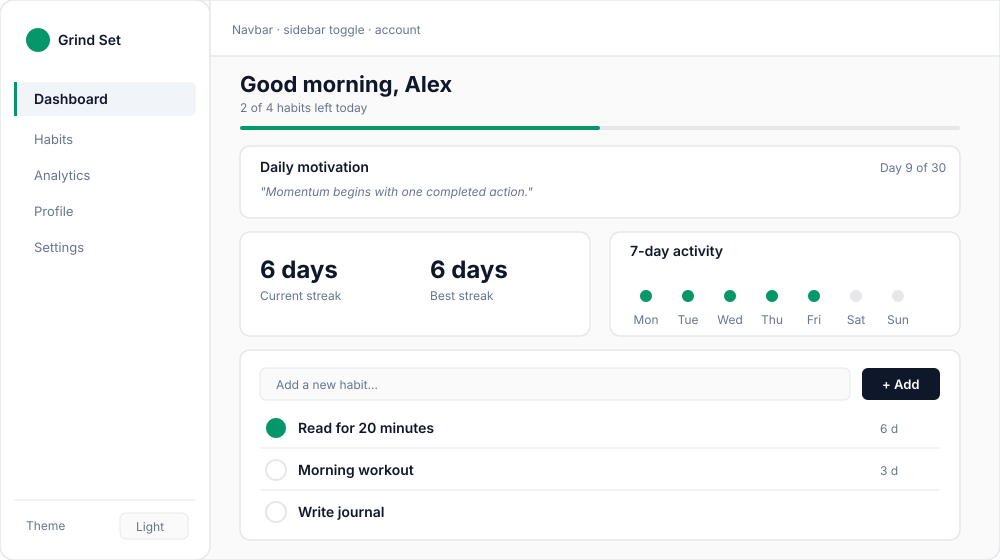
<br>
<sub>Schematic of the dashboard layout. Values shown are illustrative.</sub>
</div>

### Pages and routes

| Route | Page | Access | Purpose |
| --- | --- | --- | --- |
| `/` | Auth | Public | Sign in or create an account. `/?mode=signup` opens sign-up directly. |
| `/dashboard` | Dashboard | Protected | Daily overview and habit check-ins |
| `/habits` | Habits | Protected | Full habit list with completion and deletion |
| `/analytics` | Analytics | Protected | Statistics and the 14-day completions chart |
| `/profile` | Profile | Protected | Personal summary and editable quote |
| `/settings` | Settings | Protected | Username, logout, and account deletion |

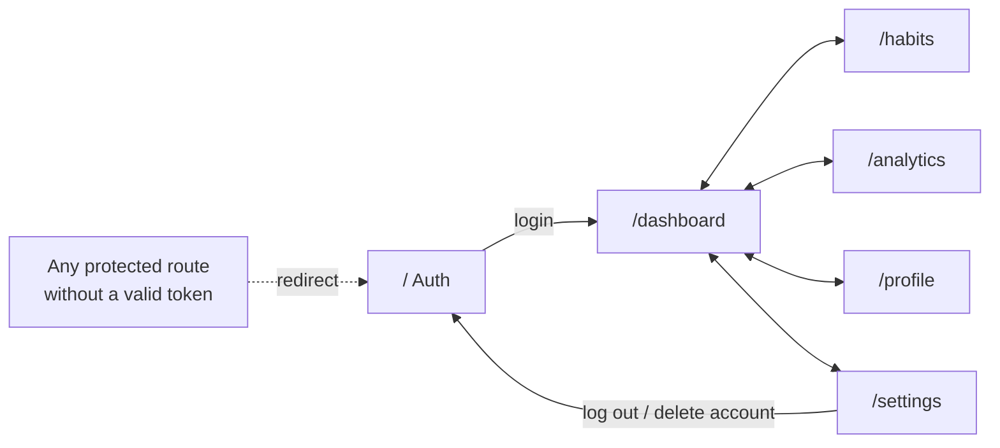

---

## Technology Stack

| Layer | Technology | Role |
| --- | --- | --- |
| Frontend | React 19, React Router 7, Create React App 5 | Single-page application and client-side routing |
| Styling | Tailwind CSS 3, CSS custom properties | Layout utilities and the light/dark design tokens in `index.css` |
| Icons | Lucide React | Interface icons |
| Backend | Node.js, Express 5 | REST API |
| Database | MongoDB Atlas, Mongoose 9 | Persistent users and habits |
| Security | bcryptjs, jsonwebtoken, cors | Password hashing, token signing and verification, cross-origin access |
| Hosting | Vercel (client), Vercel or Render (API), MongoDB Atlas | Production deployment |

---

## Architecture

### System context

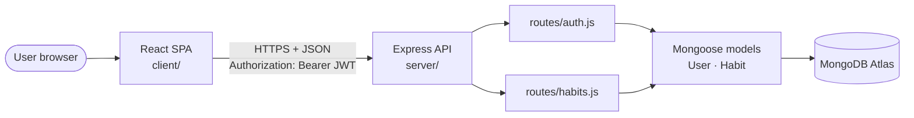

The browser never talks to MongoDB. The client reaches the API through `client/src/services/api.js`, which prefixes every call with `REACT_APP_API_URL` (or the CRA dev proxy locally) and attaches the stored JWT.

### Authentication sequence

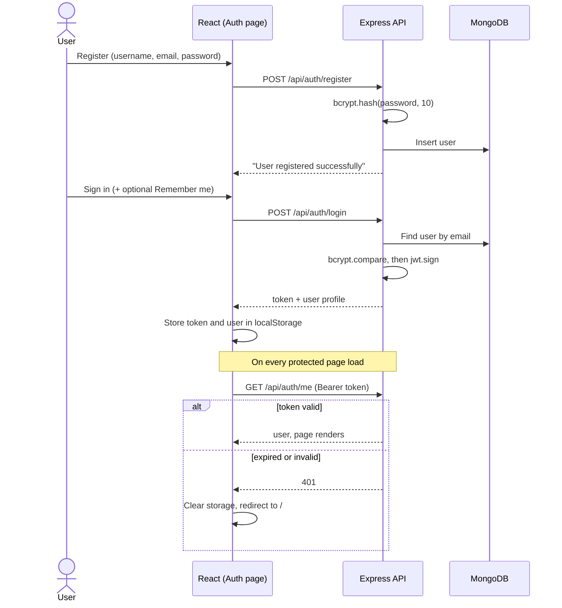

### Protected request pipeline

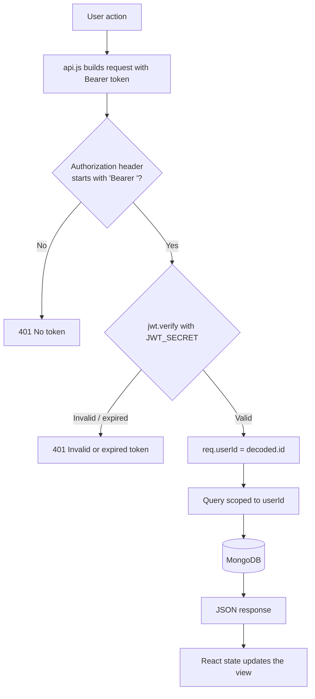

All habit queries filter by `userId`, so one account can never read or modify another account's data.

### Client composition

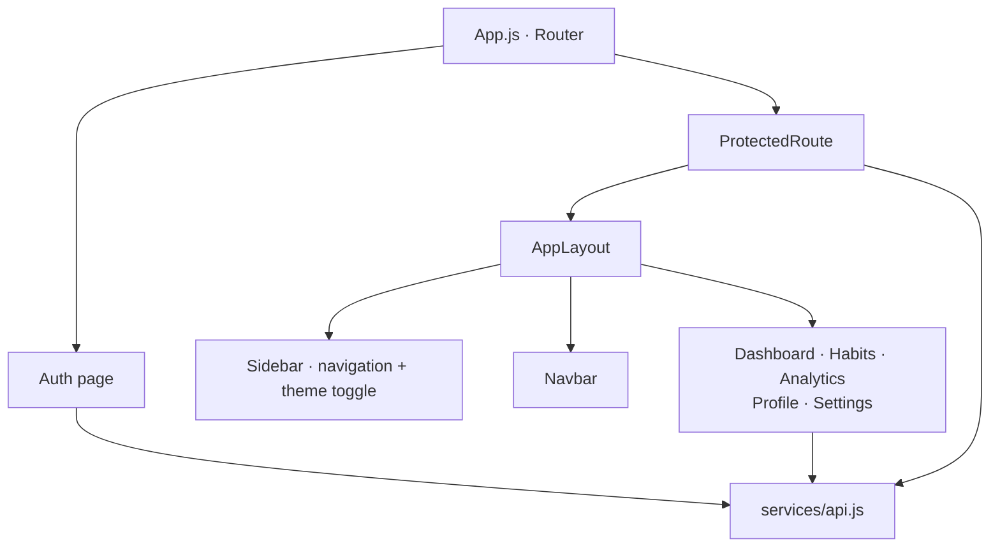

---

## Core Logic

### Daily completion and streak rules

Completion dates are stored as `Date.toDateString()` strings (for example `Mon Oct 26 2026`). Streaks are derived on read, never stored.

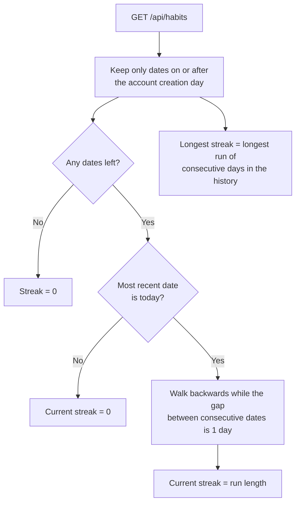

Practical consequences:

- A streak only counts if the habit was completed **today**. Completing yesterday but not yet today shows `0` until today's check-in.
- Completions recorded before the account's creation date are ignored, which keeps imported or legacy data from inflating totals.
- Marking a habit complete is idempotent: a second request on the same day changes nothing.

### Analytics definitions

| Metric | Definition |
| --- | --- |
| Total habits | Number of habits owned by the user |
| Check-ins, all time | Sum of valid completion dates across all habits |
| Average streak | Sum of current streaks divided by the number of habits, shown to one decimal place |
| Top habit | Habit with the most completions (shows "None" if there are none) |
| Completions chart | For each of the last 14 days, the number of habits completed that day; days before account creation count as zero |

Illustrative shape of the 14-day chart (sample data, not real user data):

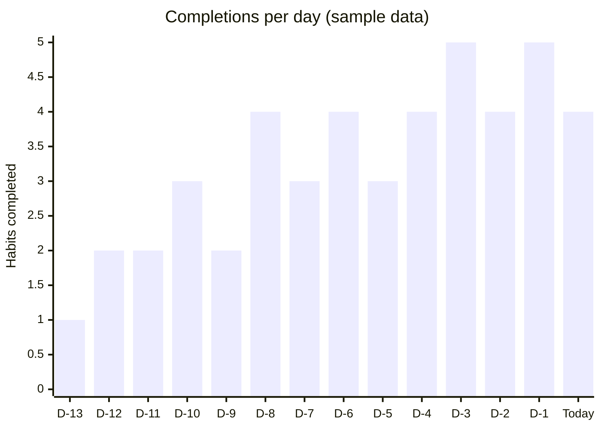

### Daily motivation

The Dashboard shows one of 30 built-in quotes, selected by the day of the month. Day 31 wraps back to the first quote, so the same quote appears for everyone on a given date.

### Theme and local preferences

| Key (`localStorage`) | Content |
| --- | --- |
| `token` | JWT for the active session |
| `user` | Cached profile (`_id`, `username`, `email`, `createdAt`) |
| `theme` and `theme:<userId>` | `light` or `dark`; the per-user key wins, the global key is the fallback |
| `profileQuote:<userId>` | The user's custom profile quote |

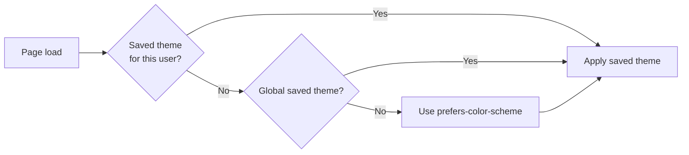

---

## Data Model

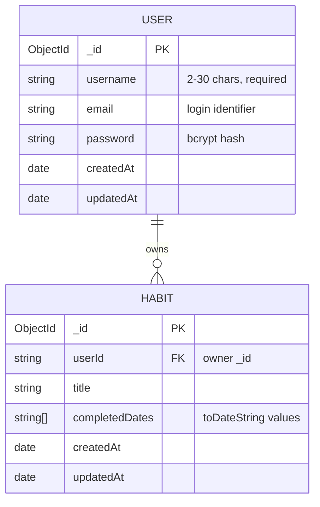

Both collections use Mongoose `timestamps`. Deleting an account removes the user and all of their habits in a single MongoDB transaction.

---

## Repository Structure

```text
Daily-Habit-Tracker/
├── client/                         React single-page application
│   ├── public/                     index.html, manifest, favicon, logos
│   ├── src/
│   │   ├── components/
│   │   │   ├── common/ProtectedRoute.jsx
│   │   │   └── layout/             Navbar.jsx, Sidebar.jsx
│   │   ├── pages/                  Auth, Dashboard, Habits, Analytics, Profile, Settings
│   │   ├── services/api.js         Fetch wrapper for every API call
│   │   ├── styles/terminal-theme.css
│   │   ├── App.js                  Routes and authenticated layout
│   │   ├── index.css               Design tokens (light and dark)
│   │   └── index.js
│   ├── tailwind.config.js
│   ├── postcss.config.js
│   ├── vercel.json                 SPA fallback rewrite
│   └── .env.example
├── server/                         Express REST API
│   ├── models/                     User.js, Habit.js
│   ├── routes/                     auth.js, habits.js
│   ├── server.js                   App setup and database connection
│   └── vercel.json                 Serverless deployment config
├── docs/assets/                    README images
├── .gitignore
└── README.md
```

---

## Getting Started

### Prerequisites

- Node.js 18 or newer and npm
- Git
- A MongoDB Atlas cluster and database user (account deletion uses a transaction, which Atlas supports)

### Installation

```bash
# 1. Clone
git clone https://github.com/Krissh360/Daily-Habit-Tracker.git
cd Daily-Habit-Tracker

# 2. Install the API dependencies
cd server && npm install

# 3. Install the client dependencies
cd ../client && npm install
```

### Configure the API

Create `server/.env`. This file is git-ignored and must never be committed.

```env
MONGO_URI=mongodb+srv://<user>:<password>@<cluster>/<database>?retryWrites=true&w=majority
JWT_SECRET=<long-random-secret>
PORT=5000
```

Generate a strong secret with:

```bash
node -e "console.log(require('crypto').randomBytes(48).toString('hex'))"
```

### Run locally

Use two terminals.

```bash
# Terminal 1: API on http://localhost:5000
cd server
npm start
```

```bash
# Terminal 2: client on http://localhost:3000
cd client
npm start
```

In development, `REACT_APP_API_URL` can stay empty. The `proxy` field in `client/package.json` forwards `/api` requests to `http://localhost:5000`.

### Verify

```bash
curl http://localhost:5000/
# API is running
```

Then open `http://localhost:3000`, create an account, add a habit, and mark it complete.

---

## Configuration

### Server (`server/.env`)

| Variable | Required | Purpose |
| --- | --- | --- |
| `MONGO_URI` | Yes | MongoDB Atlas connection string |
| `JWT_SECRET` | Yes | Secret used to sign and verify JWTs |
| `PORT` | No | Local port, defaults to `5000` |
| `NODE_ENV` | No | Runtime environment |

### Client (`client/.env`)

| Variable | Required | Purpose |
| --- | --- | --- |
| `REACT_APP_API_URL` | Production only | Public API origin, **without** a trailing `/api` (the client appends it) |

```env
REACT_APP_API_URL=https://your-api.example.com
```

---

## Available Scripts

| Location | Command | Purpose |
| --- | --- | --- |
| `client/` | `npm start` | Start the development server on port 3000 |
| `client/` | `npm run build` | Create an optimised production build in `client/build` |
| `client/` | `npm test` | Run the Create React App test runner |
| `server/` | `npm start` | Start the Express API |

---

## API Reference

Base path: `/api`. Protected endpoints require the header:

```http
Authorization: Bearer <jwt-token>
```

### Endpoint summary

| Method | Endpoint | Auth | Description |
| --- | --- | :---: | --- |
| `POST` | `/api/auth/register` | No | Create an account |
| `POST` | `/api/auth/login` | No | Verify credentials and issue a JWT |
| `GET` | `/api/auth/me` | Yes | Validate the session and return the current user |
| `PATCH` | `/api/auth/profile` | Yes | Update the username (2–30 characters) |
| `DELETE` | `/api/auth/account` | Yes | Delete the account and all habits (transactional) |
| `GET` | `/api/habits` | Yes | List habits with streak data |
| `POST` | `/api/habits` | Yes | Create a habit |
| `PUT` | `/api/habits/complete/:id` | Yes | Mark a habit complete for today |
| `DELETE` | `/api/habits/:id` | Yes | Delete a habit |
| `GET` | `/api/habits/analytics` | Yes | Aggregate statistics |
| `GET` | `/` | No | Health check, returns `API is running` |

### Authentication

<details>
<summary><strong>POST /api/auth/register</strong></summary>

```json
{ "username": "krissh", "email": "krissh@example.com", "password": "a-strong-password" }
```

Response `200`:

```json
{ "message": "User registered successfully" }
```

Errors: `400` when a field is missing or the email is already registered.
</details>

<details>
<summary><strong>POST /api/auth/login</strong></summary>

```json
{ "email": "krissh@example.com", "password": "a-strong-password", "rememberMe": true }
```

Response `200`:

```json
{
  "token": "<jwt>",
  "user": { "_id": "…", "username": "krissh", "email": "krissh@example.com", "createdAt": "…" }
}
```

The password hash is never returned. With `rememberMe: true` the token expires in 30 days.
</details>

<details>
<summary><strong>PATCH /api/auth/profile</strong></summary>

```json
{ "username": "new-display-name" }
```

Response `200`: `{ "user": { … } }`. Returns `400` if the username is outside 2–30 characters.
</details>

### Habits

<details>
<summary><strong>GET /api/habits</strong></summary>

Each habit includes computed fields:

```json
{
  "_id": "…",
  "title": "Read for 20 minutes",
  "completedDates": ["Sun Oct 25 2026", "Mon Oct 26 2026"],
  "currentStreak": 2,
  "longestStreak": 5,
  "totalCompleted": 12,
  "accountCreatedAt": "2026-09-01T08:00:00.000Z"
}
```
</details>

<details>
<summary><strong>POST /api/habits</strong></summary>

```json
{ "title": "Read for 20 minutes" }
```

Returns the created habit, or `{ "message": "Habit already exists" }` for a case-insensitive duplicate.
</details>

<details>
<summary><strong>GET /api/habits/analytics</strong></summary>

```json
{
  "totalHabits": 3,
  "totalCompletions": 12,
  "averageStreak": "4.00",
  "mostConsistentHabit": "Read for 20 minutes"
}
```
</details>

### Status codes

| Code | Meaning |
| --- | --- |
| `200` | Success |
| `400` | Validation failure or bad credentials |
| `401` | Missing, invalid, or expired token |
| `404` | User not found |
| `500` | Unexpected server error |

---

## Deployment

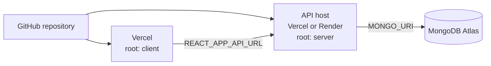

### API

`server/server.js` exports the Express app, and `server/vercel.json` routes all traffic to it for serverless hosting. It also runs as a normal long-lived Node service.

- **Vercel:** import the repository, set the root directory to `server`, and add `MONGO_URI` and `JWT_SECRET`.
- **Render (Web Service):** root directory `server`, build command `npm install`, start command `npm start`, plus the same variables and `NODE_ENV=production`.

Confirm the deployed root URL returns `API is running`.

### Client (Vercel)

1. Import the repository and set the root directory to `client`.
2. Use the Create React App preset, or build command `npm run build` with output directory `build`.
3. Set `REACT_APP_API_URL` to the API origin and redeploy.

`client/vercel.json` rewrites all paths to `index.html`, so deep links such as `/analytics` survive a refresh.

### Post-deployment checklist

- [ ] Register, sign in, and refresh a protected page
- [ ] Create, complete, and delete a habit
- [ ] Edit the username and confirm it updates in the navbar and dashboard
- [ ] Toggle the theme and reload
- [ ] Open the Analytics page with and without data

---

## Security

**Implemented**

- Passwords are hashed with bcrypt and never returned by the API.
- JWTs are verified on every protected route, and every habit query is scoped to the authenticated user ID.
- The client revalidates the session with `/auth/me` on protected routes and clears invalid sessions.
- Account deletion requires a typed `DELETE` confirmation and runs in a transaction.
- Secrets live in git-ignored `.env` files.

**Recommended hardening before a public launch** (see [Known Limitations](#known-limitations))

- Remove `tlsAllowInvalidCertificates` from the MongoDB connection.
- Restrict CORS to the deployed client origin.
- Add request rate limiting on `/auth/login` and `/auth/register`.
- Give non-persistent sessions an expiry.
- Rotate any credentials that have ever been exposed, and use a unique production `JWT_SECRET`.

Note that the JWT is held in `localStorage`, which is readable by any script running on the page.

---

## Known Limitations

An honest account of the current state, to guide contributors and reviewers:

| Area | Limitation |
| --- | --- |
| Database TLS | `server/server.js` connects with `tlsAllowInvalidCertificates: true`, which disables certificate validation. Intended for development convenience only. |
| CORS | `cors()` is open to all origins. |
| Session expiry | Tokens issued without "Remember me" have no expiry. |
| Validation | Email format and password strength are not validated on the server, and emails are not case-normalised. |
| Habit titles | Duplicate detection builds a regular expression from the raw title without escaping, so titles containing regex characters (for example `C++`) can fail. |
| Error shape | Login errors are returned as plain strings rather than `{ message }`, so the client shows its generic fallback text. |
| Best streak | The Dashboard "Best streak" currently mirrors the current streak. The API already returns `longestStreak` per habit and can supply the true value. |
| Time zones | Dates are stored as server-local `toDateString()` strings, so a day boundary follows the server clock rather than the user's. |
| Habit editing | Habits can be created, completed, and deleted but not renamed. The Dashboard "more options" button is a placeholder. |
| Tests | No automated tests exist yet. The server `test` script is a stub, and the client has testing-library installed without test files. |
| Unused dependencies | `chart.js` and `react-chartjs-2` (client) and several server packages (MUI, axios, emotion) are installed but not used. The Analytics chart is built with plain HTML and CSS. |

---

## Troubleshooting

| Symptom | Likely cause | Resolution |
| --- | --- | --- |
| Client cannot reach the API | `REACT_APP_API_URL` missing or wrong in production | Set it to the API origin without `/api`, then redeploy the client |
| `Database connection error` in server logs | Invalid `MONGO_URI` or Atlas network rule | Check credentials and add your IP to Atlas Network Access |
| Signed out unexpectedly | Token expired or `JWT_SECRET` changed | Sign in again |
| 404 after refreshing a route | SPA rewrite not deployed | Confirm `client/vercel.json` is part of the deployment |
| Account deletion fails | MongoDB deployment without transaction support | Use Atlas or a replica set |
| Port 3000 already in use | Another dev server is running | Stop it, or accept the alternative port CRA offers |
| Streak shows 0 after yesterday's check-in | Streaks require a completion today | Complete the habit today to resume the run |

---

## Roadmap

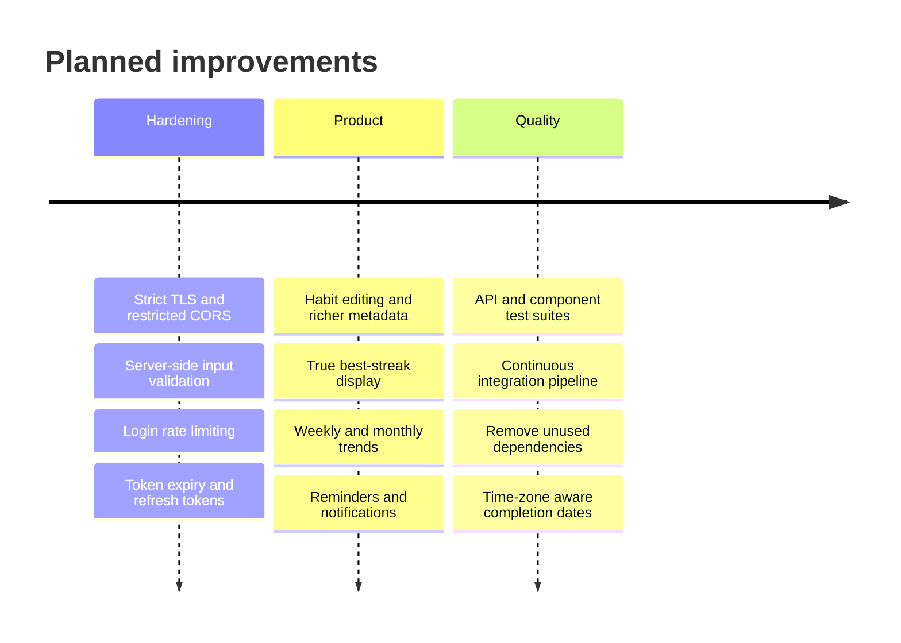

---

## Contributing

1. Create a branch from `main`:

   ```bash
   git checkout -b feature/short-description
   ```

2. Make a focused change that preserves existing behaviour.
3. Run `npm run build` in `client/` for frontend changes, and exercise the affected API routes for backend changes.
4. Commit using a descriptive, conventional-style message, for example `feat(analytics): add weekly summary`.
5. Push the branch and open a pull request against `main` with a concise summary, validation notes, and any deployment considerations.

---

## License

All rights are reserved by the author unless otherwise stated.

---

## Author

**Krissh Chhabra** · [@Krissh360](https://github.com/Krissh360)

<div align="center">
<sub>Built with focus, consistency, and a genuine interest in full-stack development.</sub>
</div>
